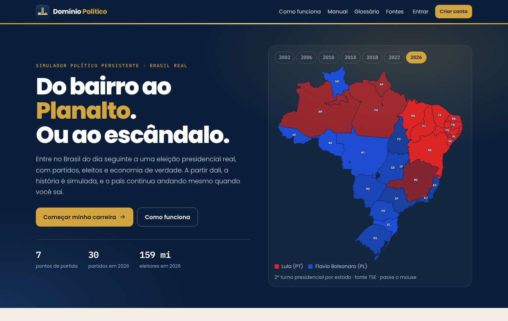
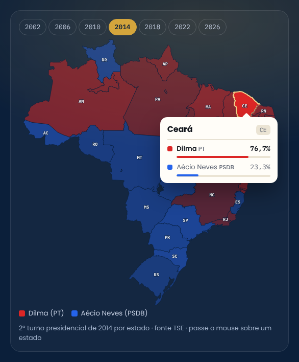
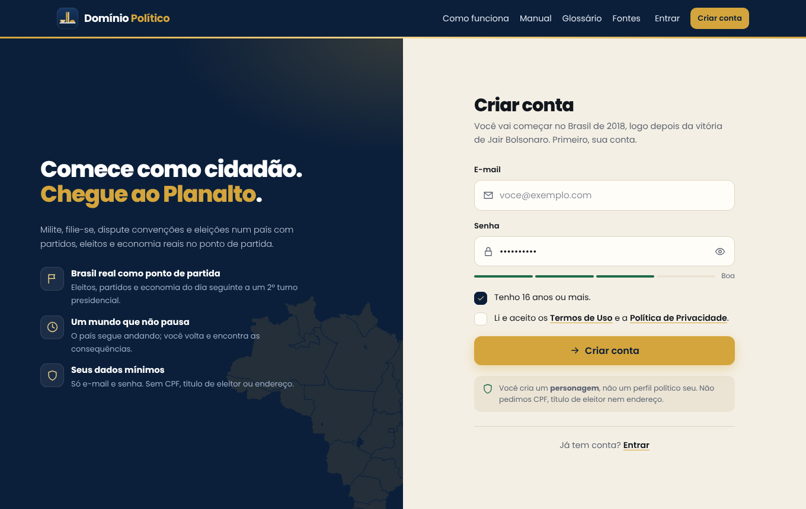
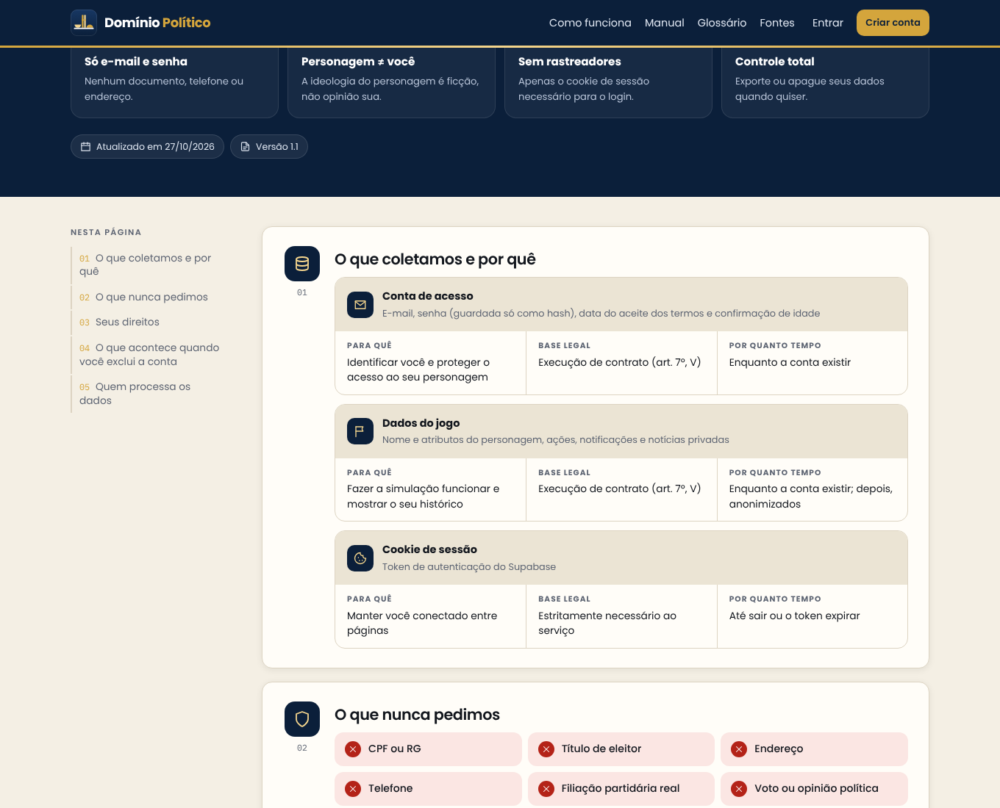
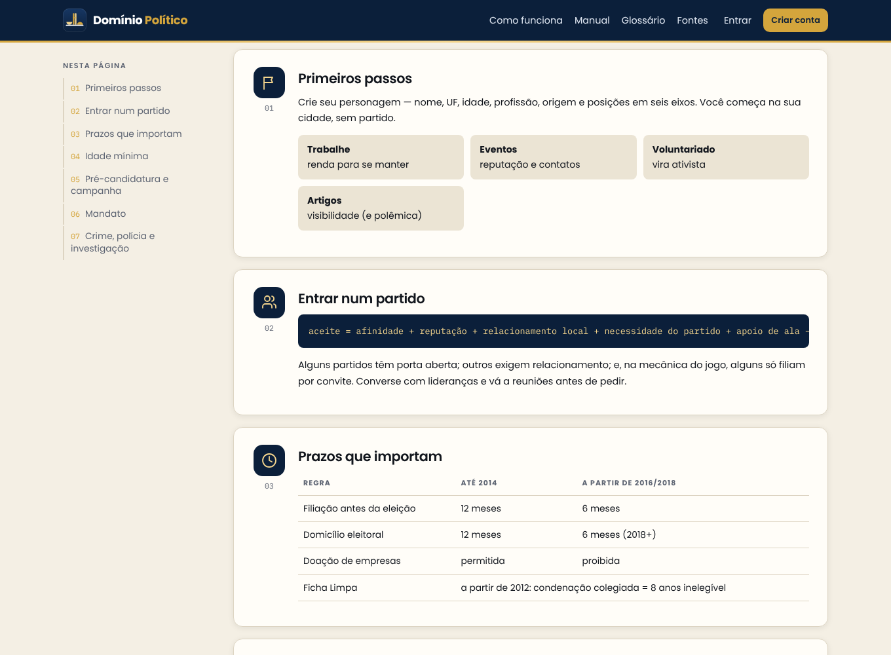
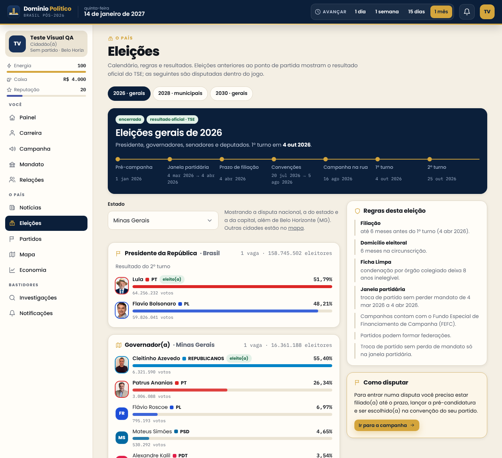
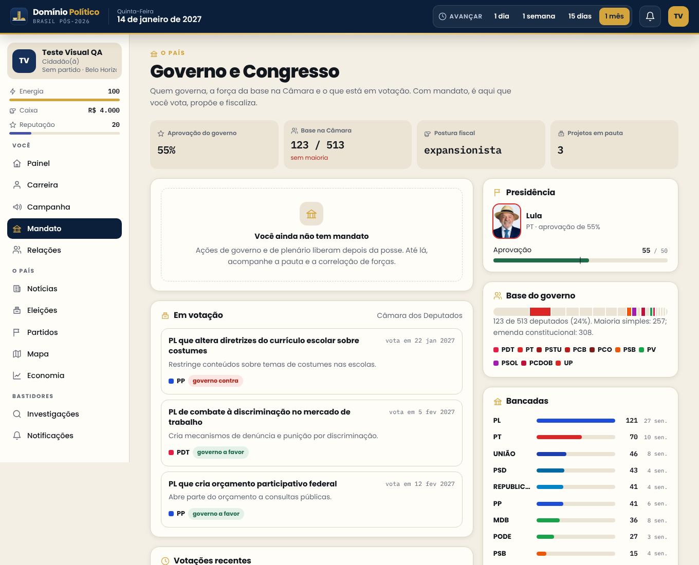
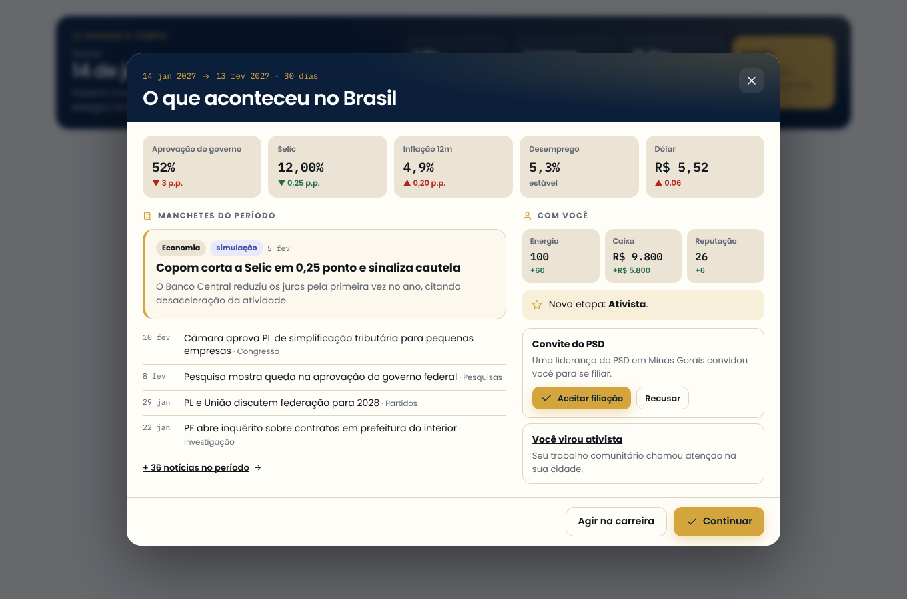

# Domínio Político · simulador de carreira política

Jogo de navegador em que você começa como cidadão comum e tenta chegar ao Planalto num Brasil que parte do real. Você escolhe o dia seguinte a um 2º turno presidencial, de 2002 a 2026, e entra num país com os partidos, os eleitos e a economia daquele momento. Dali em diante a história é simulada, e o mundo continua andando mesmo quando você sai.

> Projeto de estudo. Partidos, eleitos e resultados do ponto de partida são reais (TSE e Banco Central). Tudo o que acontece depois é simulação e vem marcado como tal. O jogo nunca atribui crimes, falas ou condições de saúde inventadas a pessoas reais.

**No ar:** [dominio-politico.com.br](https://dominio-politico.com.br) (também em [dominio-politico.vercel.app](https://dominio-politico.vercel.app))



## A ideia

A política brasileira tem regras que mudam de eleição para eleição, partidos que se fundem e trocam de nome, e uma carreira que começa muito antes da urna. O jogo tenta reproduzir isso como sistema, não como texto:

- **O motor decide, o texto narra.** Toda consequência sai de regras e sorteios reprodutíveis. As notícias só descrevem o que o motor já decidiu.
- **Fato e simulação nunca se misturam.** Cada notícia carrega a origem: "Fato real" com fonte, ou "Simulação".
- **O país não espera você.** O relógio corre a 2 dias de jogo por hora real. Copom, pesquisas, janelas partidárias, CPIs e eleições acontecem com ou sem jogadores.

### Pontos de partida

Sempre o dia seguinte ao 2º turno presidencial, com o resultado oficial do TSE. Cada ano é um mundo compartilhado e independente.

| Ano | Eleito | Votos válidos | Adversário | Em exercício | Eleitorado |
| --- | --- | --- | --- | --- | --- |
| 2002 | Lula (PT) | 61,27% | José Serra (PSDB) | Fernando Henrique | 115,3 mi |
| 2006 | Lula (PT) | 60,83% | Geraldo Alckmin (PSDB) | Lula | 125,9 mi |
| 2010 | Dilma (PT) | 56,05% | José Serra (PSDB) | Lula | 135,8 mi |
| 2014 | Dilma (PT) | 51,64% | Aécio Neves (PSDB) | Dilma | 142,8 mi |
| 2018 | Jair Bolsonaro (PSL) | 55,13% | Fernando Haddad (PT) | Michel Temer | 147,3 mi |
| 2022 | Lula (PT) | 50,90% | Jair Bolsonaro (PL) | Jair Bolsonaro | 156,5 mi |
| 2026 | Lula (PT) | 51,79% | Flavio Bolsonaro (PL) | Lula | 158,7 mi |

<p align="center">
  
</p>

## O que funciona

- **Carreira:** cidadão, ativista, aproximação partidária, filiado, quadro, pré-candidato, candidato e mandato. Cada ação gasta energia e tem retorno decrescente. A filiação pesa afinidade, reputação, trajetória (ativismo e etapa da carreira), relacionamento, necessidade do partido e alas: quem acabou de chegar à política tem de 25% a 55% de chance nos partidos mais próximos, conforme o perfil; com ativismo e reuniões, passa de 80%.
- **Partidos reais de cada ano,** com bancadas e lideranças do ponto de partida, sucessões e fusões (PFL → DEM → União, PMDB → MDB e outras), ideologia em seis eixos e culturas internas diferentes: alguns abrem a porta, outros só aceitam quem tem padrinho.
- **Eleições completas:**
  - convenções e distribuição do fundo eleitoral;
  - pesquisas com margem de erro e efeito de instituto;
  - debates;
  - majoritárias com 2º turno;
  - proporcionais com quociente eleitoral e sobras pelo método D'Hondt, federações como lista única e coligações onde a época permitia.
- **Regras por época,** calculadas pelo ano da eleição:
  - filiação de 12 meses até 2014, depois 6;
  - domicílio de 12 meses até 2016, depois 6;
  - Ficha Limpa a partir de 2012;
  - doação de empresas até 2014;
  - fundo eleitoral a partir de 2018;
  - coligações proporcionais até 2018 e federações a partir de 2022;
  - janela partidária a partir de 2016;
  - posse em 1º de janeiro até 2022, e em 5 e 6 de janeiro a partir de 2026.
- **Eleitorado por segmentos:** sete segmentos por estado, calibrados para reproduzir o 2º turno real de cada UF.
- **Economia mensal:** PIB, inflação, Selic, câmbio, desemprego e dívida a partir das séries do Banco Central. O Copom decide os juros por uma regra de Taylor, e há choques externos.
- **Governo:** projetos de lei em tramitação e políticas públicas com prazo, custo e efeito.
- **Crimes políticos com rastro (21 condutas):**
  - caixa dois, corrupção passiva e ativa, peculato, rachadinha, funcionário fantasma, notas frias na cota parlamentar, fraude em licitação, desvio de emendas, lavagem de dinheiro, compra de votos, abuso de poder econômico, uso da máquina, desinformação, candidaturas laranjas, desvio do fundo partidário, tráfico de influência, concussão, nepotismo, obstrução de justiça e enriquecimento ilícito;
  - cada conduta tem base legal conforme a época (por exemplo, Lei 8.666 antes de 2021 e Lei 14.133 depois), cargo que dá a oportunidade, ganho, rastro (documentos e testemunhas) e canais por onde costuma vir à tona: Coaf, Tribunal de Contas, Controladoria, imprensa, ex-assessores, adversários, Ministério Público Eleitoral e delação;
  - esquemas recorrentes rendem todo mês e deixam mais rastro a cada mês;
  - investigação em etapas, com quebra de sigilo, busca e apreensão, bloqueio de bens, prisão preventiva e afastamento do cargo;
  - pena calculada pelas acusações: prisão com progressão de regime, multa e devolução, cassação em ilícitos eleitorais e inelegibilidade pela Ficha Limpa;
  - dossiês mostram cada achado concreto, inclusive quando não há nada; partidos também podem ser investigados pelas contas.

  Só personagens fictícios ou de jogadores cometem crimes, e o motor cria com frequência casos entre os personagens fictícios. Eles podem ser filiados a partidos reais, e a reputação e a integridade do partido mudam pelo que eles fazem. Pessoas reais nunca são autoras nem alvos.
- **Dinheiro:** fechamento mensal com extrato por categoria: salário da profissão ou subsídio do cargo (valores de cada época, de vereador a presidente), Imposto de Renda simplificado (com a isenção até R$ 5 mil a partir de 2026), custo de vida, rendimento da reserva pela Selic, contribuição ao partido, empréstimos com juros e dinheiro não declarado separado da conta, que só volta ao bolso lavado e com perda. Os preços seguem a inflação real até o ponto de partida e, depois, o IPCA simulado mês a mês.
- **Partido próprio:** fundação com estatuto e custos, coleta de apoio de eleitores (0,5% dos votos válidos para a Câmara, com mínimo em nove estados) em até dois anos, conferência e registro no TSE, presidência da legenda, pedidos de filiação de outros políticos, convites e fidelidade partidária conforme a época (a criação de partido deixou de ser justa causa em 2015). Na eleição, a presidência indica os candidatos da legenda e, depois das convenções, reparte a cota do partido no fundo eleitoral (FEFC) entre as candidaturas; o que sobra no 1º turno volta ao Tesouro.
- **Passar o tempo:** além do relógio automático, o Painel tem um lugar único para pular 1 dia, 1 semana, 15 dias ou 1 mês. Ao fim, um resumo mostra o que aconteceu no Brasil (aprovação, Selic, inflação, desemprego, dólar e manchetes) e o que mudou para você, com atalho para responder convites.
- **Mundo compartilhado, só seu ou fictício:** na criação do personagem você escolhe onde jogar. O compartilhado reúne todos os jogadores daquele ano. O "só meu" tem os mesmos dados reais, sem outros jogadores, e o relógio fica parado até você avançar. O fictício também é só seu, mas troca todas as pessoas e partidos reais por nomes e siglas inventados (inclusive nas notícias, no mapa e nos municípios), sem fotos nem logos reais; como ninguém ali é real, qualquer político pode cometer crimes e ser investigado. Cada conta tem um mundo próprio por vez, e ele é apagado inteiro com o personagem (em Minha conta).
- **Conquistas e ranking:** 20 conquistas de carreira (primeira filiação, nome na urna, cada cargo, partido fundado, mãos limpas, inocentado e outras), registradas com a data no jogo e com aviso. Elas somam pontos com o cargo atual e a reputação no ranking dos jogadores de cada mundo. A Carreira mostra também o histórico de mandatos e eleições.
- **Relógio compartilhado:** cada ponto de partida tem um mundo compartilhado. Quem joga sozinho avança sem limite. Com outros jogadores ativos (ação nas últimas 72 horas), o relógio aceita até 60 dias de jogo por hora real somando todos, para na véspera de prazos e eleições (filiação, fim das convenções, turnos) e só cruza esses marcos 30 minutos depois do último avanço. Todo avanço fica registrado no Painel e avisa os outros jogadores.
- **Mapa político dos 5.570 municípios,** com prefeito(a) e câmara de cada cidade no ponto de partida (TSE) e zoom do país até o município. Capitais e a cidade do jogador têm disputa completa; as demais são simuladas de forma determinística a cada eleição municipal.
- **Fotos e logos reais:** fotos oficiais de candidatura do TSE (CC-BY) para 5.702 candidaturas de pessoas reais, sempre com o ano, e logos dos partidos do Wikimedia Commons, só de arquivos em domínio público ou com licença livre, com autor e licença na página de Fontes.
- **Interface do jogo:**
  - painel com próximos passos, pendências, agenda com contagem de dias e um resumo do país;
  - ações com um clique e resultado na hora;
  - notificações lidas ao abrir e convites de filiação aceitos direto do sino;
  - eleições com calendário visual e resultados em barras;
  - votação de projetos, resposta a ofertas ilícitas e conversas direto das listas;
  - primeiros passos no Painel (energia, passar o tempo, fechamento do mês, primeiro degrau e partido), que somem quando tudo estiver feito;
  - glossário com dicas nos termos sublinhados (janela partidária, FEFC, cláusula de desempenho e outros);
  - listas de pessoas com filtros por cargo, partido e UF;
  - menu lateral com grupos recolhíveis e, no celular, quatro atalhos e um menu "Mais";
  - acessibilidade: contraste AA nas cores de texto e nas pílulas, foco preso e Esc nos diálogos, setas nos menus, atalho "Pular para o conteúdo" e menos animação para quem prefere.
- **Conta:** recuperar senha por e-mail, reenviar a confirmação, trocar senha (pedindo a atual) e trocar e-mail (com confirmação no endereço novo).
- **LGPD:** exportação dos dados em JSON e exclusão da conta. Na exclusão, o personagem sai da política sem nenhum evento negativo.

### Componentes próprios

Nenhum controle tem cara de padrão do navegador:

- campo de texto com ícone;
- senha com mostrar e ocultar e medidor de força;
- caixa de seleção;
- seletor com lista, busca e teclado (padrão combobox);
- slider com zero central;
- cartões de escolha;
- contador;
- botões com carregamento;
- diálogo de confirmação;
- painel de ações em sanfona.

Os campos reais continuam acessíveis a leitores de tela, e os valores seguem para as Server Actions.

| | |
| --- | --- |
|  |  |
| **Cadastro.** Layout dividido, senha com medidor e caixas de seleção próprias. | **Privacidade.** Inventário de dados, direitos e operadores em blocos visuais. |
|  |  |
| **Manual.** Índice lateral e seções numeradas. | **Celular.** Menu compacto, sem rolagem horizontal. |

### Dentro do jogo

| | |
| --- | --- |
|  |  |
| **Eleições.** Calendário com contagem regressiva e o resultado oficial de 2026 com fotos do TSE. | **Governo e Congresso.** Base do governo, pauta da Câmara e votações recentes. |



**Resumo do período** (dados de exemplo): indicadores do país antes e depois, manchetes e o que mudou para o jogador.

## Pessoas e partidos reais

Para quem existe de verdade, o jogo só mostra fatos com fonte e desempenho simulado em cargos e eleições. A política de conteúdo é verificada depois de cada texto gerado:

| Tipo de afirmação | Pessoa real | Personagem fictício |
| --- | --- | --- |
| Fato com fonte (resultado, cargo, partido) | Sim | Sim |
| Desempenho simulado (votos, aprovação, movimentação política) | Sim | Sim |
| Crime, corrupção, traição política | Não | Sim |
| Citação, condição de saúde, deepfake | Não | Sim |

Veículos de imprensa e institutos de pesquisa do jogo são fictícios, para que nenhuma manchete ou pesquisa simulada pareça vir de uma fonte real.

## Arquitetura

```
apps/web/              site Next.js (App Router, Server Actions)
  app/                 páginas públicas, conta e o jogo em /jogo/[ano]
  components/          kit de formulário, mapa, cabeçalho e rodapé, blocos legais
  components/game/     casca do jogo: barra lateral, sino, passar o tempo, ações rápidas
  lib/sim.ts           ponte motor ↔ banco: carrega, avança o relógio, aplica ações e grava
  app/admin/           painel de saúde (restrito às contas em ADMIN_USER_IDS)
  lib/game-view.ts     leituras para as telas: próximos passos, agenda e pendências
  lib/glossary.ts      verbetes do glossário (página e dicas nas telas)
  lib/photos.json      fotos do TSE por pessoa (arquivos em public/fotos)
  lib/logos.json       logos dos partidos com licença e autor (arquivos em public/logos)
packages/engine/       motor da simulação em TypeScript puro (sem React, sem banco)
  src/                 eleições, partidos, economia, governo, crime, notícias, relógio
    crimes.ts          catálogo das condutas ilícitas (lei, oportunidade, rastro, canais, pena)
    finance.ts         subsídios, imposto, custo de vida, fundo partidário e fechamento mensal
    partyfounding.ts   fundação de partidos, apoiamento, registro e pedidos de filiação
    partycampaign.ts   chapa do partido próprio e repasse do fundo eleitoral
    clock.ts           regras do relógio compartilhado entre jogadores
    account.ts         limpeza dos dados do jogador na exclusão de conta
    achievements.ts    conquistas e pontos de carreira do ranking
    fiction.ts         modo fictício: nomes e siglas inventados, determinísticos por mundo
  test/                testes dos pontos de partida e simulação longa
packages/data/         carrega os snapshots por ano
data/                  snapshots reais (snapshot-2002.json … snapshot-2026.json)
                       e municípios por ano (municipios-2002.json … municipios-2026.json)
scripts/
  import-snapshot/     importadores do TSE e do Banco Central, municípios e fotos
  build-startpoints.mjs  gera os fatos dos pontos de partida
  build-icons.mjs        gera favicon e ícones a partir do logo
supabase/migrations/   esquema, RLS e funções do motor
supabase/templates/    e-mails de autenticação no visual do jogo
.github/workflows/     CI (tipos, testes e build) e backup diário do banco
```

**Motor determinístico.** Cada sorteio vem de `hash(semente do mundo | fase | dia | chave)`, sem `Math.random`. O mesmo mundo, com as mesmas ações, sempre produz a mesma história. Isso permite processar dias atrasados a qualquer momento e testar décadas de simulação em segundos.

**Relógio preguiçoso.** O mundo não precisa de um processo rodando: ao abrir uma página ou executar uma ação, o servidor calcula quantos dias deveriam ter passado e processa a diferença. A rota `/api/cron/tick` faz o mesmo para os mundos compartilhados e roda todo dia pelo Vercel Cron (`apps/web/vercel.json`), para que o mundo ande mesmo sem ninguém abrindo o jogo. Mundos próprios têm velocidade zero: só andam quando o dono avança.

**Mundos próprios.** O id diz o tipo: `br2026` (compartilhado), `br2026p…` (só meu) e `br2026f…` (fictício), com o começo do id da conta. No fictício, a troca de nomes é determinística (semente do mundo + nome real), então os dados estáticos dos municípios são convertidos de novo a cada carga, sem guardar uma tabela de nomes; o mundo guarda só o número de cada sigla real, para achar o partido correspondente. A função `sim_drop_world` apaga um mundo próprio inteiro e recusa os compartilhados.

**Leitura e gravação.** O estado é lido em partes paralelas e gravado em lotes paralelos; um lote que estoura o tempo do banco é dividido ao meio e tentado de novo (a gravação é idempotente). Com o jogador logado, as chamadas usam o papel autenticado, que tem mais tempo por comando. As telas usam um cache curto, descartado na hora quando o dia de jogo mudou ou o jogador agiu.

### Segurança

- **RLS em todas as tabelas.** O mundo é de leitura pública; notificações, finanças, dossiês e notícias privadas só para o dono.
- **Nenhuma escrita pelo cliente.** O motor grava por funções `SECURITY DEFINER` que exigem um segredo de servidor, guardado no banco só como hash SHA-256.
- **Sementes dos mundos e vínculo conta ↔ personagem** ficam num schema privado, fora da API.
- **Concorrência:** cada mundo tem um lease no banco, e a gravação confere o dia esperado antes de aplicar.
- **Anti-robô:** Cloudflare Turnstile no cadastro, entrada, recuperação de senha e reenvio de confirmação, conferido pelo próprio Supabase Auth (Attack Protection). Sem a chave pública configurada, o widget não aparece.
- **Coleta mínima:** e-mail e senha. Nada de CPF, título de eleitor, endereço ou telefone.

## Tecnologias

- [Next.js 15](https://nextjs.org) (App Router, Server Actions) e React 19
- TypeScript em todo o projeto, com workspaces do npm
- [Supabase](https://supabase.com): Postgres, autenticação e RLS
- [d3-geo](https://d3js.org/d3-geo) e [topojson-client](https://github.com/topojson/topojson-client) para o mapa
- [Vitest](https://vitest.dev) no motor
- Poppins e IBM Plex Mono via `next/font`
- Publicado na [Vercel](https://vercel.com) (região São Paulo); cada push na `main` gera uma nova versão

## Rodando

Requisitos: Node.js 20 ou superior e um projeto no Supabase.

```bash
npm install
npm run dev          # http://localhost:3000
npm test             # testes do motor
npm run typecheck
npm run build
```

### Banco

Rode as migrations de `supabase/migrations/` em ordem no SQL Editor (ou com a CLI do Supabase). Depois registre o hash do segredo do servidor, um por ambiente:

```sql
insert into private.app_secrets (name, hash)
values ('local', encode(extensions.digest('SEU_SIM_SECRET', 'sha256'), 'hex'));
```

Os mundos são criados sozinhos quando o primeiro jogador escolhe um ano.

### E-mails da conta

Os e-mails de autenticação, no visual do jogo, estão em `supabase/templates/`. O Supabase só deixa editar os modelos com um SMTP próprio, então a ordem é:

1. **SMTP.** O jogo usa a [Resend](https://resend.com) com o domínio `dominio-politico.com.br` verificado (registros DKIM, SPF e MX de `send.` no DNS). Em **Authentication → Emails → SMTP Settings**: host `smtp.resend.com`, porta `465`, usuário `resend`, senha = chave de API da Resend (permissão só de envio), remetente `nao-responda@dominio-politico.com.br` e nome `Domínio Político`. Depois, em **Rate Limits**, aumente o limite de e-mails por hora.
2. **Modelos** (**Authentication → Emails → Templates**):

   | Modelo | Assunto | Arquivo |
   | --- | --- | --- |
   | Confirm signup | `Confirme seu e-mail · Domínio Político` | `confirmacao.html` |
   | Reset password | `Crie uma senha nova · Domínio Político` | `recuperacao.html` |
   | Change email address | `Confirme o e-mail novo · Domínio Político` | `troca-email.html` |

3. **URLs** (**Authentication → URL Configuration**): **Site URL** `https://dominio-politico.com.br` e, nas **Redirect URLs**, `https://dominio-politico.com.br/**` (e o endereço `.vercel.app`, se ainda for usado).

O link do e-mail usa `token_hash` e passa pela rota `/auth/callback`, então a confirmação funciona mesmo quando a pessoa abre o e-mail em outro aparelho, e ela volta para onde estava indo (por exemplo, a criação de personagem do ano escolhido).

### Variáveis de ambiente

Em `apps/web/.env.local` (fora do Git):

| Variável | Obrigatória | Descrição |
| --- | --- | --- |
| `NEXT_PUBLIC_SUPABASE_URL` | Sim | URL do projeto Supabase. |
| `NEXT_PUBLIC_SUPABASE_PUBLISHABLE_KEY` | Sim | Chave publicável do Supabase. |
| `SIM_SECRET` | Sim | Segredo do motor. O hash dele precisa estar em `private.app_secrets`. |
| `NEXT_PUBLIC_SITE_URL` | Em produção | URL pública, usada nos links de confirmação de e-mail. |
| `NEXT_PUBLIC_TURNSTILE_SITE_KEY` | Não | Chave pública do Cloudflare Turnstile. A chave secreta vai no Supabase (Authentication → Attack Protection), não aqui. |
| `ADMIN_USER_IDS` | Não | Ids das contas (separados por vírgula) que podem abrir `/admin`. |
| `MAX_PRIVATE_WORLDS` | Não | Quantos mundos próprios podem existir ao mesmo tempo (cada um ocupa alguns MB). Padrão: 30. |
| `CRON_SECRET` | Não | Protege `/api/cron/tick`. Sem ele, a rota usa o `SIM_SECRET`. |
| `WORLD_GAME_DAYS_PER_HOUR` | Não | Velocidade do relógio. Padrão: 2 dias por hora real. |
| `WORLD_MAX_CATCHUP_TICKS` | Não | Máximo de dias processados por requisição. Padrão: 45. |

### Backup e CI

- **CI** (`.github/workflows/ci.yml`): a cada push e pull request, roda `typecheck`, os testes do motor e o build.
- **Backup diário** (`.github/workflows/backup.yml`): `pg_dump` do banco, criptografado com GPG e guardado por 30 dias como artefato do GitHub Actions. Precisa de dois segredos no repositório: `SUPABASE_DB_URL` (a string de conexão do pooler de sessão, em Supabase → Connect) e `BACKUP_PASSPHRASE` (a senha do arquivo). Para restaurar: baixe o artefato, rode `gpg -d backup.sql.gz.gpg | gunzip | psql "$URL"`.

### Dados

Os snapshots já estão em `data/`. Para gerar de novo a partir do TSE e do Banco Central:

```bash
npm run import:2026
npm run import:historico -- --year 2018
npm run build:startpoints
```

Os arquivos do TSE ficam em cache em `.cache/tse/` (fora do Git).

## Testes e validação

| Verificação | Resultado |
| --- | --- |
| `npm test`: os 7 pontos de partida reproduzem o eleito real, 513 cadeiras na Câmara e 81 no Senado; municípios e eleições municipais; crimes nunca atribuídos a pessoas reais; dossiês; fundação de partido até o registro; chapa e fundo eleitoral do partido próprio; subsídios e imposto por época; filiação de novatos; inflação simulada; relógio compartilhado; exclusão de conta; conquistas; mundo fictício sem nenhuma pessoa ou sigla real; simulação de 2026 até depois da eleição de 2030 | 34 de 34 |
| `npm run test:integration`: criação do mundo, personagem, ações e avanço de 15 dias contra o Supabase real | aprovado |
| `npm run test:private-world`: mundo fictício próprio criado (7,5 s), carregado, com personagem, avançado 7 dias e apagado | aprovado |
| Totais do 2º turno contra o TSE (ex.: Lula 2002 com 52.793.364 votos, Lula 2022 com 60.345.999) | iguais |
| `npm run typecheck` e `npm run build` | sem erros |
| Rolagem horizontal em 390 e 1360 px nas páginas públicas e do jogo, temas claro e escuro | nenhuma |

**Limites conhecidos:**

- Nem toda candidatura tem foto: o TSE só publica fotos a partir de 2004, e parte dos arquivos não existe.
- Os logos seguem a sigla e a época do ponto de partida, mas nem toda sigla antiga tem logo com licença livre (PSDC e PT do B, por exemplo); essas aparecem pela sigla e cor.
- Os dados de um mundo próprio seguem a regra de leitura dos mundos (públicos para quem conhece o id); notificações, finanças e dossiês continuam só do dono.
- O ranking compara só jogadores do mesmo mundo.

## Créditos

Dados: [Tribunal Superior Eleitoral](https://dadosabertos.tse.jus.br) (CC-BY, incluindo as fotos de candidatura), [Banco Central do Brasil](https://www3.bcb.gov.br/sgspub) (SGS) e malhas do [IBGE](https://www.ibge.gov.br) via [geodata-br](https://github.com/tbrugz/geodata-br).

Logos dos partidos: [Wikimedia Commons](https://commons.wikimedia.org/wiki/Category:Logos_of_political_parties_in_Brazil), cada um com a licença e o autor listados na página [Fontes](https://dominio-politico.vercel.app/fontes). As marcas pertencem aos partidos; o uso é só de identificação, sem relação com eles.

Design e código: [Saymon Oliveira](https://saymonthedev.com).
